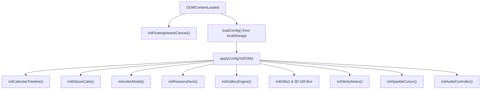

# 🏛️ Architecture & Technical Design

This document details the architectural layout, technology stack, directory organization, and state management of the birthday surprise web application.

---

## 🗂️ File Categorization & Organization

```
birthday/
│
├── 📄 index.html                  # Main application entry point & semantic markup
├── 🎨 style.css                   # Complete design system, 3D CSS transforms & animations
├── ⚡ script.js                   # Application controller, audio synthesis & interactions
│
├── 🖼️ Media & Visual Assets
│   ├── photo1.jpg                 # Hero memory frame 1
│   ├── photo2.jpg                 # Hero memory frame 2
│   ├── photo3.jpg                 # Hero memory frame 3
│   ├── photo4.jpg                 # Gallery memory 1 (First trip)
│   ├── photo5.jpg                 # Gallery memory 2 (Her smile)
│   ├── photo6.jpg                 # Gallery memory 3 (Sunset walk)
│   ├── photo7.jpg                 # Gallery memory 4 (Cafe dates)
│   ├── photo8.jpg                 # Gallery memory 5 (Us forever)
│   ├── luxury_bouquet.png         # High-resolution flower bouquet asset
│   └── romantic-hearts-pattern.svg# Vector heart pattern background
│
├── 📚 Documentation (docs/)
│   ├── FEATURES.md                # Detailed breakdown of all 10 interactive features
│   ├── ARCHITECTURE.md            # Technical architecture, lifecycle & state flow
│   └── DEPLOYMENT.md              # Local setup & 1-click hosting deployment guide
│
├── ⚙️ Configuration
│   ├── .gitignore                 # Excludes system and temporary editor caches
│   └── README.md                  # Primary repository overview & quickstart
```

---

## 🛠️ Technology Stack

| Layer | Technology | Purpose |
|---|---|---|
| **Structure** | Semantic HTML5 | Accessible, SEO-friendly layout with WCAG aria attributes |
| **Styling** | Modern CSS3 | Custom variables, Flexbox/Grid, CSS 3D transforms, Glassmorphism (`backdrop-filter`) |
| **Typography** | Google Fonts | `Playfair Display`, `Cinzel`, `Great Vibes`, `Dancing Script`, `Plus Jakarta Sans` |
| **Interactivity** | Vanilla JavaScript (ES6+) | Modular architecture with zero heavy framework overhead |
| **Audio** | Web Audio API | Procedural sound generation (oscillators, biquad filters, gain nodes) |
| **Graphics** | HTML5 Canvas | Lightweight particle physics for floating heart canvas |
| **Celebration** | Canvas-Confetti (CDN) | Confetti cannons, fireworks bursts, and heart particle showers |
| **State** | Browser `localStorage` | Client-side persistence for personalized settings & wish wall notes |

---

## 🔄 Application Lifecycle & Execution Order



---

## 💾 State & Data Management

The application operates without backend servers, storing all user modifications in browser `localStorage` under the key:

```json
{
  "birthday_surprise_config": {
    "recipient": "Bangaru",
    "sender": "Ne Bujjulu",
    "letter": "Full Telugu love letter text...",
    "photos": [
      "photo4.jpg",
      "photo5.jpg",
      "photo6.jpg",
      "photo7.jpg",
      "photo8.jpg"
    ]
  },
  "birthday_wish_notes": [
    "May all your dreams come true! ✨",
    "Happy Birthday My Queen! ❤️"
  ]
}
```

This guarantees 100% privacy, instantaneous response times, zero server maintenance costs, and persistent custom memories across reloads.
